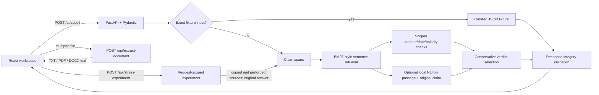

# Architecture

React owns editing and API-driven result rendering. FastAPI validates requests and responses. `backend/service.py` keeps fixture selection, segmentation, retrieval, narrow checks and conservative verdict aggregation local and deterministic. No audit makes an external network call.

Claims are sentence spans of the original answer; source passages are original source sentences. Offsets count Python Unicode code points and are half-open. Pydantic checks every claim slice, sentence span, source reference and quote slice before returning the response.

The upload route reads each file in memory with a 10 MiB default cap (`REFUTELLA_MAX_UPLOAD_BYTES`), validates its extension and expected format signature, and extracts UTF-8 text, PDF page text through `pypdf`, or DOCX paragraphs/table cells through `python-docx`. It returns text and a safe basename; the browser adds that text as a normal editable `SourceDocument` with a generated source ID. There is no upload-specific audit service, filesystem persistence, OCR, or external service call. The backend caps extracted text at the existing 30,000-character source limit and checks DOCX archive expansion size before parsing. Complex PDF layouts may not preserve reading order.

Retrieval normalizes Unicode word tokens and ranks sentences with a BM25-style formula. It reserves the top eligible sentence from each source, then fills additional slots to `max(3, source_count)`; one long source cannot crowd out all other documents. Scores only order evidence discovery. They are not claim truth scores. For custom input, support is asserted only for normalized whole-claim/text identity in an unquoted passage. Numeric and date checks require one comparable value/date, compatible units for quantities, highly overlapping content context and no competing values; otherwise the check abstains. Polarity checks require otherwise identical wording with an explicit negation or a small antonym pair, and skip quoted passages. Conflicting evidence is ambiguous; otherwise the verdict abstains as insufficient. Causal ambiguity requires claim wording about causation and an explicit nearby source qualification that it does not state, establish, show or prove causation.

The local NLI adapter is optional and disabled unless `REFUTELLA_NLI_MODEL_PATH` points to a local model directory. It only assesses the claim against passages already selected by lexical retrieval. Quotes, overlength pairs, missing weights and inference errors are reported as inconclusive/unavailable; no model output can create evidence. Exact quotations and source offsets remain derived from the supplied text. Model logits and the heuristic decision thresholds are uncalibrated. See Research Notes for the inspected model, license and untested resource requirements.

The method remains limited: token overlap can retrieve irrelevant passages, NLI can misread context or negation, numeric context matching can still be wrong, number formats/units are only partly normalized, and sentence splitting does not perform linguistic claim decomposition. Model-assisted mode is not a general truth check.

The Phase 3 Evidence Stress Lab accepts a previously returned, integrity-validated baseline and a source/passage operation. It copies the source models, validates the source and retrieved sentence identifiers, then calls the same `run_audit` service with the unchanged original answer and modified source context. It omits the scenario ID on the perturbed call, preventing an exact fixture shortcut from being applied to the changed material. Passage edits preserve surrounding source text and the ordinary sentence splitter/retriever computes new evidence IDs and offsets. If removing evidence empties the only source, the experiment reports not comparable because the audit request contract requires non-empty source context. A fixture baseline is also reported as not directly comparable with the perturbed live engine output. No fixture file, baseline object, or persisted state is mutated. Experiments use the currently configured optional NLI verifier; deleted or unselected passages cannot be sent to NLI because the standard retrieval path chooses eligible evidence anew.

The lab compares actual outputs; unchanged verdicts do not demonstrate model memory leakage or evidence independence. Evidence sensitivity is not a test of parametric memory leakage. Persistence, history, exports and authentication are outside this implementation.

## Phase 5A claim triage and identities

The answer splitter retains every span. Narrow auditable heuristics flag obvious questions, command patterns, short unpunctuated headings/labels, and explicit first-person opinion phrases as `NOT_ASSESSED`. Flagged spans carry a human-readable reason and may be included by passing their stable-in-response claim IDs in `assess_claim_ids`. This does not use an LLM or network classifier, and uncertain wording stays in ordinary claim assessment. Response totals count all returned spans, with a separate `not_assessed` count.

Source labels are request-order presentation labels (`S1`, `S2`, …); `source_id` remains the immutable identity used by evidence references, stress operations, and API traces. Removing or reordering sources recalculates labels from the current request order.
# Phase 5B additions

The retrieval pass records its ranked candidates directly into each finding's Search Receipt; it is not rerun for display. Source duplicate detection is request-local, preserves every input, and labels conservative near matches without inferring independent provenance. `backend/review_flags.py` owns the maintained review cue rules. Flags annotate wording and never affect verdict selection. Model-only contradiction becomes `AMBIGUOUS` / `MODEL_FLAG`; only deterministic contradiction checks produce `CONTRADICTED`. Deterministic numeric, date, and narrow polarity mismatches expose source/claim offsets only when one exact token pair is identifiable. Fixed week/day durations normalize; month/week comparisons abstain.
