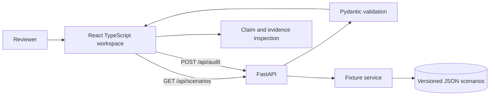

# Architecture

## Responsibilities

- React UI owns editing, scenario selection, submission, findings navigation and evidence display. It contains no fixture results.
- Vite serves frontend and proxies /api to FastAPI.
- FastAPI validates requests and owns response contract.
- Pydantic validates IDs, counts and offsets.
- JSON files under data/scenarios are curated fixtures.
- Fixture service returns a scenario result only when ID, answer and sources match exactly. Custom input receives an insufficient response.

## System diagram

## Request flow
The app fetches scenario input from GET /api/scenarios. Reviewer submits the current text and optional scenario ID to POST /api/audit. Server selects a fixture only if all fixture text matches exactly. Otherwise it returns unassessed spans with INSUFFICIENT_EVIDENCE. Response validation runs before JSON is returned. UI renders API fields only.

## Evidence flow
Each source is split into simple sentence spans with stable IDs. Evidence references include source ID, sentence ID, quote and half-open offsets. Response validation checks IDs, quote slice and sentence bounds. Claim spans use offsets into original answer. Indexes count Python Unicode code points.

## Errors
Invalid requests use standard 422 detail responses. Network failures show backend guidance. Unknown/custom input returns warnings and insufficient verdicts, never a false live analysis. Future pipeline failures should preserve independent results and mark unresolved checks explicitly.

## Planned verifier pipeline (not implemented)
1. Segment sentences and carefully decompose claims without assuming every sentence is atomic.
2. Retrieve evidence with lexical/BM25 ranking.
3. Apply narrow deterministic checks for supported numbers, dates, units and negation.
4. Optionally call a local verifier adapter with explicit model mode.
5. Validate source IDs, quotes and spans; safely reject invalid references.
6. Aggregate supported, contradicted, insufficient and ambiguous outcomes with uncertainty warnings.

No support remains insufficient; contradiction requires counter-evidence. Model scores are uncalibrated until independently measured.

## Optional local verifier
No model is loaded in Phase 1. HHEM-2.1-Open appears compatible with an AutoModel pair-scoring adapter per its current Hugging Face card, but the card instructs trust_remote_code. Before adoption, inspect the code at an immutable revision, pin Transformers dependencies, test inference on project hardware, and require opt-in before weight download. It cannot guarantee truth by itself.

## Future Evidence Stress Lab
Represent source revisions/mutations and derived audit runs without overwriting original text. Compare verdict, evidence and score for the same answer/configuration. Source-edit response does not establish that an answer model leaked parametric knowledge.
