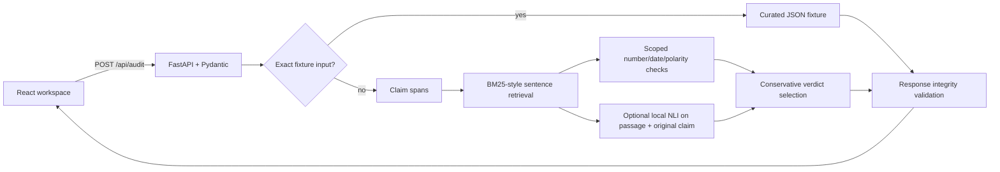

# Architecture

React owns editing and API-driven result rendering. FastAPI validates requests and responses. `backend/service.py` keeps fixture selection, segmentation, retrieval, narrow checks and conservative verdict aggregation local and deterministic. No audit makes an external network call.

Claims are sentence spans of the original answer; source passages are original source sentences. Offsets count Python Unicode code points and are half-open. Pydantic checks every claim slice, sentence span, source reference and quote slice before returning the response.

Retrieval normalizes Unicode word tokens and ranks sentences with a BM25-style formula. It reserves the top eligible sentence from each source, then fills additional slots to `max(3, source_count)`; one long source cannot crowd out all other documents. Scores only order evidence discovery. They are not claim truth scores. For custom input, support is asserted only for normalized whole-claim/text identity in an unquoted passage. Numeric and date checks require one comparable value/date, compatible units for quantities, highly overlapping content context and no competing values; otherwise the check abstains. Polarity checks require otherwise identical wording with an explicit negation or a small antonym pair, and skip quoted passages. Conflicting evidence is ambiguous; otherwise the verdict abstains as insufficient. Causal ambiguity requires claim wording about causation and an explicit nearby source qualification that it does not state, establish, show or prove causation.

The local NLI adapter is optional and disabled unless `REFUTELLA_NLI_MODEL_PATH` points to a local model directory. It only assesses the claim against passages already selected by lexical retrieval. Quotes, overlength pairs, missing weights and inference errors are reported as inconclusive/unavailable; no model output can create evidence. Exact quotations and source offsets remain derived from the supplied text. Model logits and the heuristic decision thresholds are uncalibrated. See Research Notes for the inspected model, license and untested resource requirements.

The method remains limited: token overlap can retrieve irrelevant passages, NLI can misread context or negation, numeric context matching can still be wrong, number formats/units are only partly normalized, and sentence splitting does not perform linguistic claim decomposition. Model-assisted mode is not a general truth check.

Phase 3 includes the Evidence Stress Lab. Persistence, history, exports and authentication are outside this implementation.
