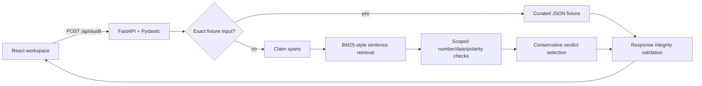

# Architecture

React owns editing and API-driven result rendering. FastAPI validates requests and responses. `backend/service.py` keeps fixture selection, segmentation, retrieval, narrow checks and conservative verdict aggregation local and deterministic. No audit makes an external network call.

Claims are sentence spans of the original answer; source passages are original source sentences. Offsets count Python Unicode code points and are half-open. Pydantic checks every claim slice, sentence span, source reference and quote slice before returning the response.

Retrieval normalizes Unicode word tokens and ranks sentences with a BM25-style formula. It reserves the top eligible sentence from each source, then fills additional slots to `max(3, source_count)`; one long source cannot crowd out all other documents. Scores only order evidence discovery. They are not claim truth scores. For custom input, support is asserted only for normalized whole-claim/text identity in an unquoted passage. Numeric and date checks require one comparable value/date, compatible units for quantities, highly overlapping content context and no competing values; otherwise the check abstains. Polarity checks require otherwise identical wording with an explicit negation or a small antonym pair, and skip quoted passages. Conflicting evidence is ambiguous; otherwise the verdict abstains as insufficient. Causal ambiguity requires claim wording about causation and an explicit nearby source qualification that it does not state, establish, show or prove causation.

The method is intentionally conservative and has predictable blind spots: paraphrase support is usually insufficient, token overlap can retrieve irrelevant passages, numeric context matching can still be wrong, number formats/units are only partly normalized, and sentence splitting does not perform linguistic claim decomposition. There is no local or remote model adapter. The Vectara HHEM feasibility assessment remains in Research Notes; it was not installed or run.

Phase 3 includes the Evidence Stress Lab. Persistence, history, exports, authentication and model integration are outside this implementation.
